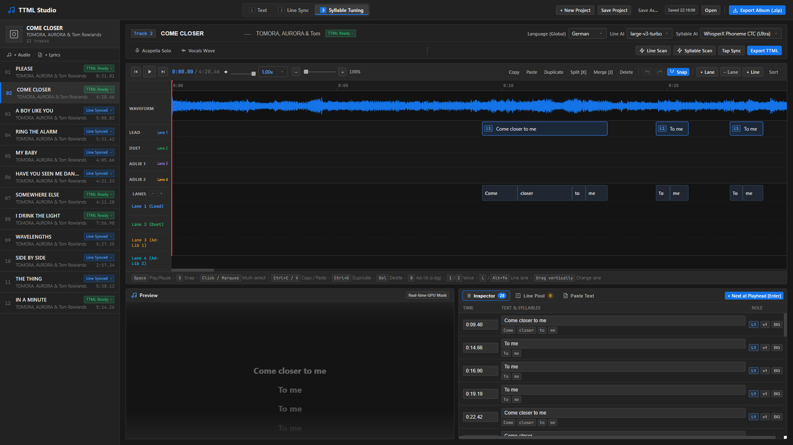
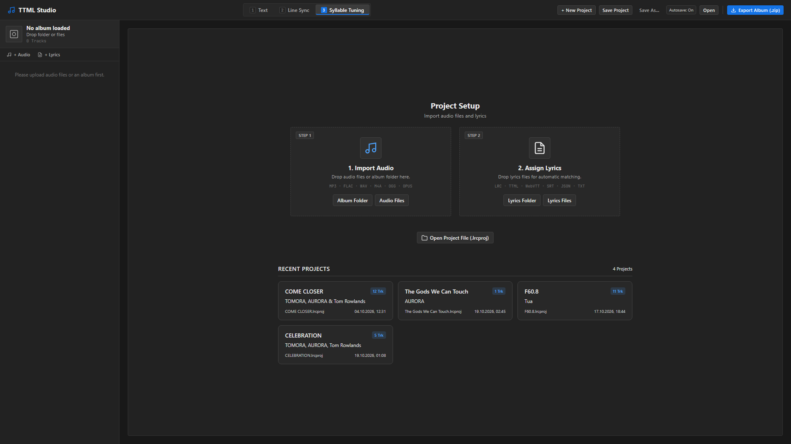
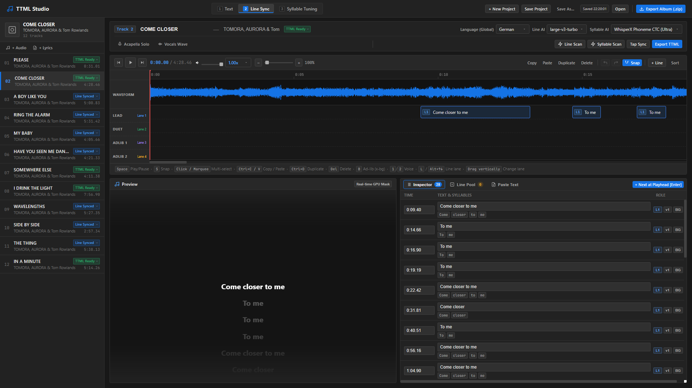

# LRCGen - TTML Lyrics Studio

**Professional, 100% local All-in-One Studio for time- and syllable-synchronized lyrics.**

Create industry-standard lyrics files for Apple Music, Spotify, YouTube Music, and streaming services:
- **Apple Music TTML (`.ttml`)**: Syllable-by-syllable timed lyrics with smooth karaoke sweep animation, multi-singer duets (v1, v2), and background ad-libs (`x-bg`).
- **Enhanced LRC (`.lrc`) & Standard LRC**: Word- and line-synchronized lyrics for music players and streaming platforms.

Zero cloud subscriptions. Zero API costs. Runs entirely on your local machine with NVIDIA GPU hardware acceleration.

---

## Highlights

### 1. Multi-Track Studio Workspace



Full-featured multi-track audio workstation:
- **Multi-Lane Timeline**: 4 dedicated lanes for Lead Vocals, Duets (`v2`), and Background Ad-libs.
- **Syllable-Level Alignment**: Waveform-anchored syllable blocks with Millisecond precision.
- **Apple Music Sweep Preview**: Real-time karaoke sweep preview directly below the timeline.
- **Full Album Inspector**: Synchronize entire albums track-by-track with unified project persistence.

---

### 2. Photoshop-Style Recent Projects Dashboard



- **Recent Projects**: Quickly resume recent albums and songs with modification timestamps and track counters.
- **Non-Destructive Autosaves**: Automated snapshots saved directly inside each project folder (`.autosave/`).
- **Direct Disk Overwrite (`Ctrl+S`)**: Instant local file saving without browser download dialogs.
- **Universal Importer**: Drop any audio folder (FLAC, MP3, WAV, M4A, OGG, OPUS) and lyrics files (TTML, LRC, SRT, VTT, TXT).

---

### 3. Precision Line & Syllable Alignment



- **Stage 0 (UVR AI)**: High-speed vocal separation isolates clean vocals from heavy instrumentals, drums, and bass.
- **Stage 1 (Line Sync)**: Global alignment calculates start and end timestamps for every line using WhisperX and Wav2Vec2.
- **Stage 2 (Syllable Tuning)**: Phonetic syllabification with Pyphen and acoustic phoneme boundary matching.
- **Stage 3 (Studio Tuning)**: Precision trimming, splitting (`X`), merging (`J`), and lane shifting.

---

## Requirements

- **Operating System**: Windows 10/11, Linux, or macOS
- **Python**: Version **3.10 to 3.13** (Python 3.14+ is currently not supported due to CTranslate2 / WhisperX dependencies)
- **GPU**: NVIDIA RTX (20xx / 30xx / 40xx / 50xx series) recommended for GPU acceleration; CPU fallback supported

---

## Quick Start

### 1. Automatic Installation (Windows)

Run the included installer:

```bat
install.bat
```

The installer automatically:
1. Validates your Python version (3.10–3.13).
2. Sets up a local virtual environment (`venv`).
3. Installs PyTorch with CUDA 12.6 support for modern NVIDIA GPUs.
4. Installs WhisperX, FastAPI, UVR audio-separator, and all required tools.

### 2. Manual Installation

```bash
# 1. Create and activate virtual environment
python -m venv venv
venv\Scripts\activate        # Windows
# source venv/bin/activate   # Linux/macOS

# 2. Install PyTorch with CUDA 12.6 (or CPU)
pip install torch torchvision torchaudio --index-url https://download.pytorch.org/whl/cu126

# 3. Install WhisperX and dependencies
pip install whisperx
pip install "audio-separator[gpu]>=0.24.0"
pip install -r requirements.txt
```

### 3. Launch Studio

```bat
start.bat
```

Or manually:

```bash
python -m uvicorn app:app --host 127.0.0.1 --port 8001
```

The application opens automatically in your browser at `http://127.0.0.1:8001`.

---

## Keyboard Shortcuts

| Shortcut | Scope | Action |
|---|---|---|
| `Space` | Timeline | Play / Pause playback |
| `Ctrl+S` / `Cmd+S` | Global | Save project directly to disk (`.lrcproj`) |
| `X` | Timeline | Split syllable at playhead or mouse cursor |
| `J` | Timeline | Join / merge selected adjacent syllables |
| `B` | Timeline | Toggle background ad-lib status (`x-bg`) |
| `L` / `Alt+↑` / `Alt+↓` | Timeline | Move selected line to adjacent lane (Lead / Duet / Adlib) |
| `Shift+Click` / Marquee | Timeline | Multi-select blocks across lanes |
| `Ctrl+C` / `Ctrl+V` | Timeline | Copy and paste selected lines or syllables |
| `Ctrl+Scroll` | Timeline | Cursor-anchored horizontal timeline zoom |
| `Delete` / `Backspace` | Timeline | Remove selected syllable or line block |
| `Space` *(Tap Sync)* | Tap Sync | Mark line start timestamp and advance |
| `Backspace` *(Tap Sync)* | Tap Sync | Step back to previous line |
| `Escape` | Modal | Close open dialog or cancel tap sync |

---

## Vocal Separation Models (UVR5 / MDX-Net)

| Model ID | Architecture | Best For |
|---|---|---|
| `UVR-MDX-NET-Inst_HQ_3` | MDX-Net | General use, fast and clean separation (recommended) |
| `UVR-MDX-NET-Voc_FT` | MDX-Net | Vocal-heavy acoustic tracks |
| `UVR_MDXNET_KARA_2` | MDX-Net | Karaoke tracks with faint backing vocals |
| `htdemucs_ft` | Demucs v4 | Complex orchestral and multi-layered arrangements |

---

## Supported Export Formats

- **Apple Music TTML (`.ttml`)**: Complete Apple Music specification with syllable markers (`<span begin="..." end="...">`), singer IDs (`ttm:agent="v1"` / `"v2"`), and ad-lib styling.
- **Enhanced LRC (`.lrc`)**: Line- and word-level timestamps (`[mm:ss.xx]<mm:ss.xx>word<mm:ss.xx>`).
- **Standard LRC (`.lrc`)**: Line-synchronized karaoke file compatible with all players.
- **Album Package (`.zip`)**: Bundles all synchronized TTML and LRC files for the complete album in one archive.

---

## Tech Stack

- **Backend**: FastAPI, Uvicorn, Python 3.10–3.13
- **AI Speech Recognition**: OpenAI Whisper, WhisperX (CTranslate2 batched inference)
- **Acoustic Phoneme Alignment**: Wav2Vec2 CTC Loss
- **Stem Isolation**: audio-separator (MDX-Net / Demucs v4 ONNX)
- **Frontend**: Vanilla JavaScript (Modular ES6), WaveSurfer.js v7, CSS3 Variables Design System
- **Typography**: Inter & JetBrains Mono

---

## License

This program is free software licensed under the terms of the GNU General Public License v3 (GPL-3.0).
